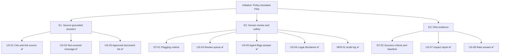

# Epic Map: Policy Assistant Pilot

**Initiative:** Help support agents answer policy questions faster without increasing answer risk. Four-week pilot.

✅ = PM-accepted or PM-edited. DT-01 and DT-02 are agent-proposed and waiting for a PM decision.

| Epic | Goal | Pilot constraint it covers | Items |
|---|---|---|---|
| E1: Source-grounded answers | Agents can trust and check where an answer came from | Approved documents only; source traceability | US-01, US-02, US-03 |
| E2: Human review and safety | Risky answers are reviewed before they reach customers | Human review for flagged answers; legal disclaimer wording | DT-01, US-04, US-05, US-06, NFR-01 |
| E3: Pilot evidence | The sponsor can decide whether to keep the assistant | Evidence that it saves time without increasing risk | DT-02, US-07, US-08 |

## Dependencies

- US-01 depends on US-03, because it needs an approved list to cite from.
- US-04 depends on DT-01 or US-05, because it needs something that produces flags.
- US-06 depends on DT-01, because legal defines the disclaimer types in the same session as the flag rules.
- US-07 depends on DT-02 (success criteria and baseline) and US-08 (accuracy data).

## Scope boundaries

**In scope for the pilot**
- Answers from approved policy documents only, with cited sources.
- Human review of flagged answers before customer use.
- A before/during comparison report for the sponsor.

**Out of scope for the pilot** (proposed, PM to confirm)
- Sending answers to customers without an agent in between.
- Searching documents that aren't approved.
- Automatically editing or creating policy content.
- Automatic risk scoring beyond the rules agreed in DT-01.
